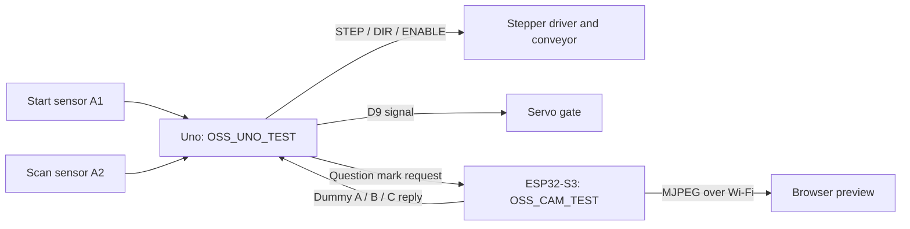

# Architecture and implementation status

The recovered firmware controls a stepper-driven belt, servo gate, and start/scan sensors. Streaming, image collection, and inference are separate camera experiments.

## Observed paired test

The image has no effect on the test response. Separately, OSS_NEW_TEST generates its own angle sequence on the Uno, while OSS_Three_Object runs inference and prints predictions on an AI Thinker pinout.

The intended recognition path is image capture → recognition → decision → sorting. No recovered file converts model output into a validated decision byte for the Uno. Class names, confidence policy, and physical bin mapping remain unresolved.

## Technical evidence

| Source | Design described | Interpretation |
| --- | --- | --- |
| [Reference PDF](references/object-sorting-conveyor.pdf) | ESP32-CAM, A4988/NEMA17 belt, SG90 gate, no CNC shield, RED/GREEN/BLUE lines | Design narrative; paired code instead uses shield-style pins and `?`/A/B/C bytes |
| [Recovered firmware](../firmware/README.md) | STEP/DIR belt, servo gate, start/scan sensors, independent camera experiments | Primary evidence for software behavior |
| [Model exports](../models/README.md) | `0/1/2` or `red/white` detection | Neither proves a red/green/blue mapping |

The technical reference describes an intended design; the recovered firmware is the primary evidence for implemented behavior. The reference's integration and performance claims have not been verified. The existing GPL license is retained.
