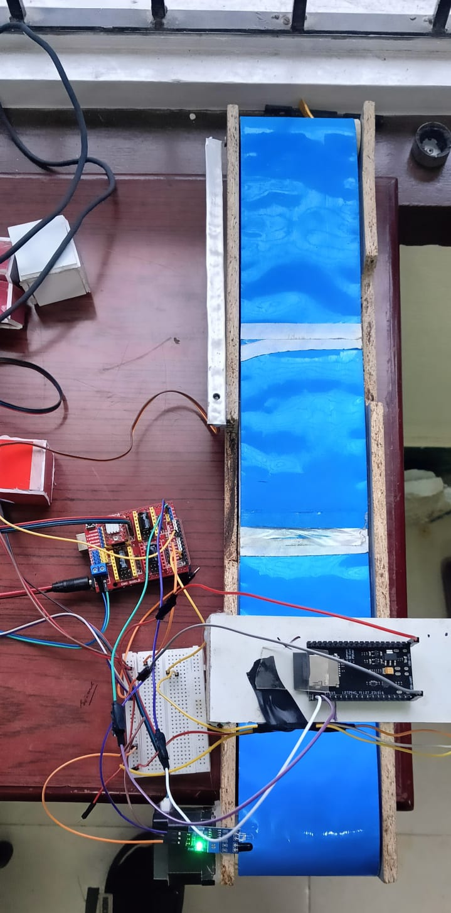
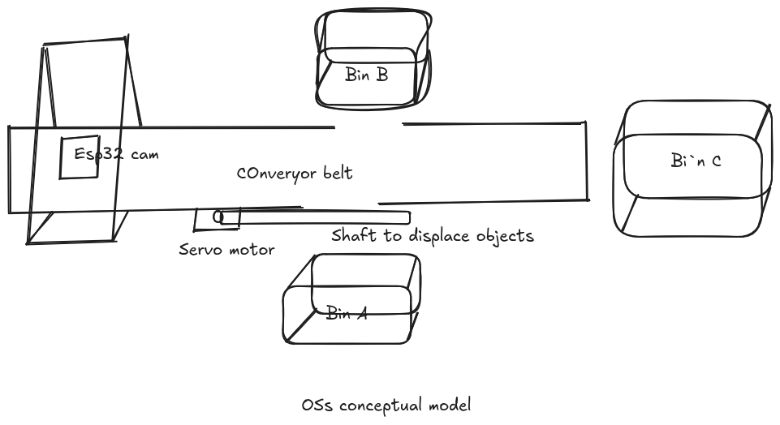
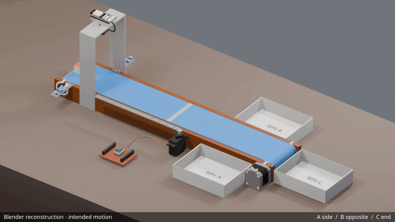

# Prototype, concept, and animation

## Physical exhibition prototype



The [original photograph](prototype-photo.jpeg) shows the physical model built for the YATRA 5.0 national event. It was supplied as `oss_demo_model.jpeg` and is preserved byte-for-byte.

The [original hardware video](prototype-test-not-working.mp4), supplied as `oss_demo_video_notworking.mp4`, is a 9.79-second unsuccessful test. The robot did **not** work as intended. The footage shows movement, but it does not establish successful recognition, sorting, or accuracy.

## User's intended mechanism



The [drawing](oss-conceptual-model.png), supplied as `oss_conceptual_model.png`, is preserved unchanged. A and B are on opposite sides of the belt; C is at its end. A camera overlooks the loading area and a side-mounted servo turns a long arm across the belt.

Original-file hashes are recorded in [source-media.json](source-media.json).

## Completed Blender reconstruction



The [editable scene](../../hardware/mechanical/oss_simulation.blend) completes the previous model using its original frame, loop belt, rollers, shafts, bearings, camera bridge, motor, and servo. The downloaded IR sensor and Freenove board geometry provide the electronics detail. [Reference analysis](../../hardware/mechanical/reference-analysis.md) separates measured source features from reconstruction choices.

This is an **18-second keyframed illustration of intended motion**, not a physical dynamics, firmware, or AI test. A and B demonstrate side routing by the long sweep arm; C continues to the end. The encoded animation carries a small persistent reconstruction label. The original failed hardware recording remains separate.

## Play or download

The GIF above plays in GitHub's README renderer. Download [H.264 MP4](https://github.com/SuhanVerse/Object_sorting_Robot/raw/refs/heads/main/docs/media/intended-sorting-simulation.mp4) or [VP9 WebM](https://github.com/SuhanVerse/Object_sorting_Robot/raw/refs/heads/main/docs/media/intended-sorting-simulation.webm).

For a browser player with controls, after cloning:

```sh
python3 -m http.server 8765
```

Open [http://localhost:8765/docs/media/player.html](http://localhost:8765/docs/media/player.html). The player tries MP4 and WebM and keeps download/GIF links available. It can also be opened locally as [player.html](player.html); using the local server is the tested path. GitHub's HTML source viewer does not execute this player.

The previous MP4 decoded and played in a browser test. The prior README supplied an ordinary file link rather than an embedded video player. The revised delivery therefore includes an inline GIF, an actual local video player, and explicit downloads rather than relying on GitHub's repository file viewer.

Video formats: 1280 × 720, 24 fps, 432 frames, 18 seconds, no audio. The README GIF is 800 pixels wide at 8 fps.

See [native scene validation](simulation-validation.json), [playback results](playback-validation.json), and [generated-asset hashes](generated-assets.json). [Mechanical documentation](../../hardware/mechanical/README.md) includes reproduction commands.
