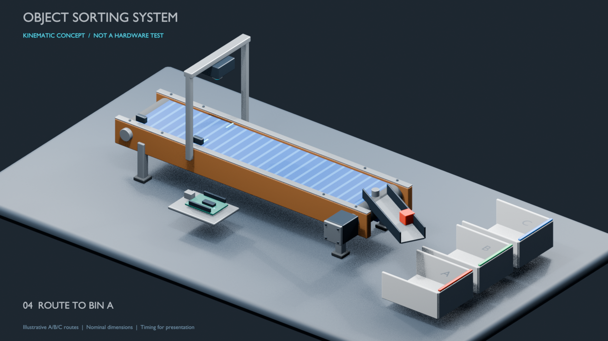

# Mechanical design and Blender animation

## Updated visualization



[Watch the 15-second concept animation](../../docs/media/intended-sorting-simulation.mp4) or open [oss_simulation.blend](oss_simulation.blend) in **Blender 5.2.2 LTS**. Press Space to play frames 1–360 at 24 fps; Numpad 0 switches to the presentation camera. Named objects and materials are editable. The Timeline has phase markers, and an internal `READ ME | animation assumptions` text explains the model.

The scene includes timber side rails, a blue belt, rollers, a stepper, camera gantry, two sensor housings, a conceptual controller, a servo-driven routing guide, and three bins. All geometry uses native primitives and procedural materials; the new scene has no external image dependencies or scripted drivers.

Each 120-frame cycle demonstrates loading, travel to the camera, a scan pause, routing, and reset. Cycles A, B, and C start at frames 1, 121, and 241. The belt texture and rollers move during travel; each object finishes in its illustrative destination bin.

This is a **keyframed kinematic concept**, not a rigid-body, sensor, firmware, or AI simulation. The 0.60 m belt length follows approximate proportions from the original scene, not measured fabrication dimensions. The routing guide and bin arrangement are visualization choices. Colors, gate angles, travel distances, and three five-second cycles are not verified hardware or model-label mappings.

## Rebuild and render

Run these commands from the repository root with Blender 5.2 and FFmpeg on PATH:

```sh
blender --background --factory-startup --disable-autoexec --python scripts/blender/create_simulation.py -- --still docs/media/simulation-preview.png --frames-dir /tmp/oss-frames
ffmpeg -framerate 24 -start_number 1 -i /tmp/oss-frames/frame_%04d.png -frames:v 360 -c:v libx264 -crf 20 -pix_fmt yuv420p -movflags +faststart -an docs/media/intended-sorting-simulation.mp4
```

The [generator](../../scripts/blender/create_simulation.py) writes the native scene before rendering. To render an edited scene instead, use:

```sh
blender --background --disable-autoexec hardware/mechanical/oss_simulation.blend --render-output /tmp/oss-frames/frame_ --frame-start 1 --frame-end 360 --render-anim
```

Validate native scene structure and key poses:

```sh
blender --background --disable-autoexec hardware/mechanical/oss_simulation.blend --python scripts/blender/validate_simulation.py -- docs/media/simulation-validation.json
```

[Recorded validation](../../docs/media/simulation-validation.json) checks timeline, camera, scan holds, final positions, and lack of external image dependencies/drivers. It does not check physical collisions or fit. Refresh hashes in `docs/media/generated-assets.json` after intentional asset changes.

## Preserved source model

| File | Description |
| --- | --- |
| [conveyer_belt.blend](conveyer_belt.blend) | Original primary Blender scene, unchanged |
| [conveyer_belt.blend1](conveyer_belt.blend1) | Different original backup, unchanged |
| [Original concept render](../../docs/assets/conveyor-render.png) | Recovered blender/Untitled.png, identical bytes |

The original scene was opened successfully with Blender 5.2.2 LTS. It references five unavailable oak texture images; the updated scene avoids that dependency. Its dimensions and suitability for fabrication remain unvalidated. No STL files, measured drawings, or assembly measurements were supplied. Original spelling is retained for traceability.

The [actual prototype photo and unsuccessful test video](../../docs/media/README.md) are separate from the concept render. See [source inventory](../../docs/source-inventory.md) for preserved-source hashes.
